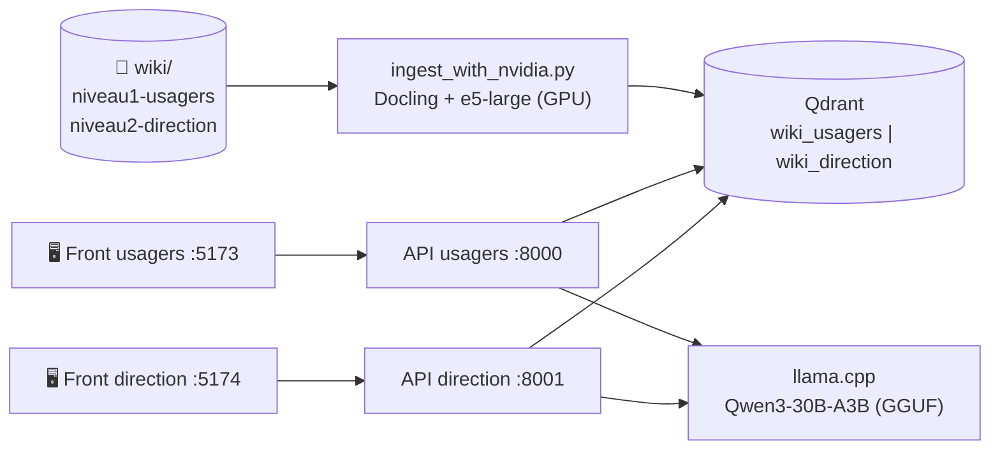

<h1 align="center">RAG-2i — Projet de fin d'études<br/>Assistant documentaire intelligent par RAG, 100 % local</h1>

<p align="center">
  <strong>Projet de fin d'études (5ᵉ année d'école d'ingénieurs) : un système de Retrieval-Augmented Generation
  permettant d'interroger en langage naturel la base documentaire interne d'une organisation, en toute confidentialité,
  avec des réponses factuelles et sourcées.</strong>
</p>

<p align="center">
  <a href="http://creativecommons.org/licenses/by-sa/4.0/"></a>
  
  
  
  
  
</p>

---

## 📖 Sommaire
<p align="center">
  <a href="#-contexte-et-objectifs">🎯 Contexte</a> •
  <a href="#-fonctionnalités">🚀 Fonctionnalités</a> •
  <a href="#-architecture">🏗 Architecture</a> •
  <a href="#-pipeline-dingestion">⚙️ Pipeline</a> •
  <a href="#-quick-start">⚡ Quick Start</a> •
  <a href="#-bilan-et-enseignements">📝 Bilan</a> •
  <a href="#-auteurs">👤 Auteurs</a>
</p>

## 🎯 Contexte et objectifs

Dans une organisation, l'information utile (procédures, règlements, documentations techniques, notes internes)
est dispersée dans des centaines de fichiers PDF, Word ou PowerPoint. La retrouver prend du temps,
et les assistants d'IA en ligne ne sont pas envisageables pour des documents confidentiels.

**Objectifs du projet :**
- permettre de poser une question en français et d'obtenir une réponse **fondée uniquement sur les documents internes** ;
- **citer les sources** de chaque réponse pour qu'elle reste vérifiable ;
- tout exécuter **en local**, sans qu'aucune donnée ne sorte de l'infrastructure ;
- séparer les documents par **niveau d'accès** (usagers / direction) ;
- tenir sur un serveur équipé d'un seul GPU NVIDIA.

## 🚀 Fonctionnalités
- **Chat en langage naturel** : questions et réponses en français, dans une interface web inspirée de ChatGPT.
- **Sources citées** : chaque réponse indique les documents utilisés et leur score de pertinence.
- **Architecture locale** : LLM, embeddings et base vectorielle tournent sur la machine ; aucune donnée ne sort.
- **Multi-formats** : PDF, DOCX, DOC (converti via LibreOffice), PPTX, XLSX, Markdown et texte.
- **Deux niveaux d'accès** : une instance d'API et une interface par niveau (`usagers` / `direction`),
  chacune reliée à sa propre collection Qdrant.
- **Ingestion incrémentale** : un manifeste (`manifest.json`) mémorise l'empreinte de chaque fichier :
  seuls les documents nouveaux ou modifiés sont retraités.
- **Accélération GPU** : extraction (Docling) et vectorisation sur GPU NVIDIA lorsqu'il est disponible.

## 🏗 Architecture



| Composant | Technologie |
|---|---|
| Frontend | React + Vite + Tailwind CSS |
| API | FastAPI (Python 3.12) |
| Base vectorielle | Qdrant (Docker) |
| Extraction et découpage | Docling (layout, tableaux) + HybridChunker |
| Embeddings | `intfloat/multilingual-e5-large` (SentenceTransformers) |
| LLM | Qwen3-30B-A3B quantifié Q4_K_M, servi par `llama-server` (llama.cpp), API compatible OpenAI |

## ⚙️ Pipeline d'ingestion

1. **Parcours** du dossier `wiki/` : le sous-dossier (`niveau1-usagers` ou `niveau2-direction`) détermine la collection cible.
2. **Détection des changements** : l'empreinte MD5 du fichier est comparée à celle du manifeste ; les fichiers inchangés sont ignorés.
3. **Conversion** : les anciens `.doc` sont convertis en `.docx` avec LibreOffice en mode headless.
4. **Extraction** avec Docling (structure du document, tableaux), accélérée sur GPU.
5. **Découpage** avec le `HybridChunker` de Docling (512 tokens maximum, la limite du modèle e5),
   puis **regroupement** des petits morceaux en blocs de 300 à 500 mots pour donner plus de contexte au LLM.
6. **Vectorisation** sur GPU et envoi à Qdrant par lots de 100, après suppression de l'ancienne version du fichier.
   Les métadonnées conservées sont le fichier, la catégorie, le numéro de page et l'index du morceau.

## 📋 Prérequis rapides
- **GPU NVIDIA** (recommandé, avec `nvidia-container-toolkit`)
- **RAM** : 24 Go minimum
- **Docker & Docker Compose**
- **Python 3.10+**
- **llama.cpp** et un modèle au format GGUF

## ⚡ Quick Start

Pour une installation détaillée, voir le [Manuel d'utilisation](./MANUEL_UTILISATION.md).

1. **Préparer les données** :
   placez vos documents dans `RAG/wiki/niveau1-usagers/` et `RAG/wiki/niveau2-direction/`.

2. **Lancer le LLM** :
   ```bash
   ./bin/llama-server --model <votre_modele.gguf> --n-gpu-layers 99 --ctx-size 8192 --host 0.0.0.0 --port 8080
   ```

3. **Démarrer l'infrastructure** :
   ```bash
   docker-compose up -d
   ```

4. **Ingérer les documents** :
   ```bash
   sudo docker exec -it rag_api_usagers python ingest_with_nvidia.py
   ```

5. **Accéder aux interfaces** : `http://localhost:5173` (usagers) et `http://localhost:5174` (direction).

## 📚 Documentation
- [Manuel d'utilisation](./MANUEL_UTILISATION.md) : guide complet d'installation et de dépannage.
- [API Docs](http://localhost:8000/docs) : documentation Swagger de l'API (une fois lancée).

## 📝 Bilan et enseignements

**Ce que le projet nous a appris :**
- le choix du **découpage** a autant d'impact sur la qualité des réponses que le choix du LLM ;
- un modèle d'embedding a une **limite de tokens** (512 pour e5) qu'il faut respecter à l'ingestion ;
- faire cohabiter un LLM de 30B, l'extraction Docling et les embeddings sur **un seul GPU** demande
  d'arbitrer la mémoire (embeddings de requête sur CPU, quantification Q4 du LLM) ;
- une API **compatible OpenAI** rend le LLM interchangeable (llama.cpp, vLLM…) sans changer le code.

**Limites identifiées :**
- l'isolation des niveaux repose sur deux instances d'API distinctes, sans authentification ;
- l'ingestion se lance uniquement en ligne de commande ;
- un seul passage est transmis au LLM par question ;
- les modèles E5 attendent le préfixe `passage: ` à l'indexation, absent dans cette version ;
- pas de tests automatisés.

➡️ Ces limites sont traitées dans **[RAG École](https://github.com/DHoudetot-Cyril/RAG)**, le prolongement personnel
de ce projet : une API unique avec authentification par rôle, une ingestion depuis l'interface, des tests,
une CI et une évaluation de la recherche.

## 🤝 Contribution
Les contributions sont les bienvenues !

1. **Fork** le projet.
2. Crée ta **feature branch** (`git checkout -b feature/AmazingFeature`).
3. **Commit** tes changements (`git commit -m 'Add: Something amazing'`).
4. **Push** sur ta branche (`git push origin feature/AmazingFeature`).
5. Ouvre une **Pull Request**.

---

## 📄 Licence
Distribué sous licence **Creative Commons BY-SA 4.0**. Voir le fichier [`LICENSE.txt`](./LICENSE.txt).

---

## 👤 Auteurs
Projet de fin d'études réalisé par :
<a href="https://github.com/DHoudetot-Cyril">Cyril D'houdetot</a> et <a href="https://github.com/PhantomSKZT">Léo Vandenberghe</a>

<p align="center">
Développé par des étudiants de 5ᵉ année dans le cadre de leur projet de fin d'études
</p>
