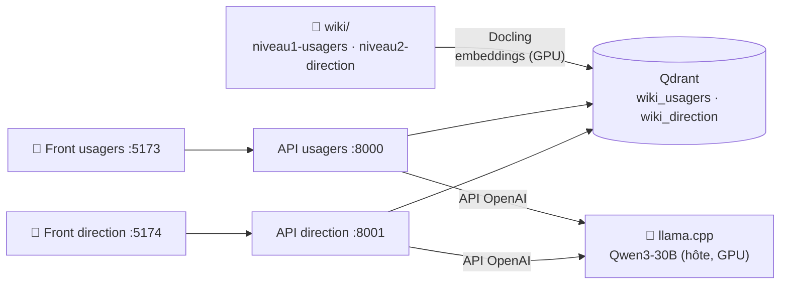

<h1 align="center">📚 RAG-2i</h1>

<p align="center">
  <strong>Assistant documentaire 100 % local pour interroger une base de documents internes en langage naturel,<br/>
  avec des réponses sourcées et deux espaces séparés : usagers et direction.</strong>
</p>

<p align="center">
  
  
  
  
  
  
  
  
  
</p>

---

**Projet de fin d'études** réalisé en binôme à l'IG2I. Les documents d'un établissement (PDF, Word, PowerPoint)
sont lus, découpés et indexés. On pose ensuite sa question en français, et un LLM qui tourne sur la machine
répond **uniquement à partir de ces documents**, en citant ses sources. Aucune donnée ne sort de l'infrastructure.

> 💡 La suite de ce projet, avec contrôle d'accès par clé d'API, tests et CI, est
> [RAG École](https://github.com/DHoudetot-Cyril/RAG).

## ✨ Fonctionnalités

- **💬 Chat en langage naturel**, en français.
- **📎 Sources citées** : chaque réponse indique les documents utilisés et leur score de pertinence.
- **🚫 Pas de réponse inventée** : si aucun passage n'est assez pertinent, l'assistant le dit au lieu de répondre.
- **🔐 Deux niveaux d'accès** : une collection Qdrant, une API et une interface pour les *usagers*, et les mêmes pour la *direction*.
- **📄 Ingestion multi-formats** : PDF, DOCX et PPTX lus avec **Docling** (structure et mise en page conservées), embeddings calculés sur GPU.
- **♻️ Détection des modifications** : une empreinte MD5 par fichier, gardée dans un manifeste, évite de ré-indexer ce qui n'a pas changé.
- **🏠 100 % local** : LLM Qwen3-30B (GGUF) servi par **llama.cpp**.

## 🏗️ Architecture



| Brique | Technologie |
|---|---|
| Interface | React + Vite + Tailwind |
| API | FastAPI (Python) |
| Base vectorielle | Qdrant |
| Ingestion | Docling (structure et mise en page) + HybridChunker + SentenceTransformers |
| LLM | llama.cpp, Qwen3-30B-A3B (GGUF), ou tout serveur compatible OpenAI |

## 🚀 Démarrage rapide

### Prérequis

- **Docker** et Docker Compose, avec le **NVIDIA Container Toolkit**
- Un **GPU NVIDIA** (recommandé) et **24 Go de RAM**
- **llama.cpp** et un modèle GGUF

### Lancement

```bash
git clone https://github.com/DHoudetot-Cyril/rag-2i.git
cd rag-2i

# 1. Déposer les documents
mkdir -p wiki/niveau1-usagers wiki/niveau2-direction

# 2. Lancer le LLM sur la machine hôte
./bin/llama-server --model <votre_modele.gguf> --n-gpu-layers 99 --ctx-size 8192 --host 0.0.0.0 --port 8080

# 3. Démarrer Qdrant, les API et les interfaces
docker compose up -d

# 4. Indexer les documents
docker exec -it rag_api_usagers python ingest_with_nvidia.py
```

| Interface | URL |
|---|---|
| 🧑 Usagers | http://localhost:5173 |
| 🏢 Direction | http://localhost:5174 |
| 📖 API (Swagger) | http://localhost:8000/docs |

👉 Installation détaillée et dépannage : [Manuel d'utilisation](./MANUEL_UTILISATION.md).

## 📁 Structure du projet

```text
rag-2i/
├── RAG/
│   ├── rag.py                  # API FastAPI : recherche + génération
│   ├── ingest_with_nvidia.py   # ingestion Docling + embeddings (GPU)
│   └── Dockerfile
├── frontend/                   # interface React (Vite + Tailwind)
├── docker-compose.yml          # Qdrant + 2 API + 2 interfaces
└── MANUEL_UTILISATION.md
```

## 👥 Auteurs

Projet de fin d'études réalisé en binôme par
**[Cyril D'Houdetot](https://github.com/DHoudetot-Cyril)** et **[Léo Vandenberghe](https://github.com/PhantomSKZT)**.

Distribué sous licence [CC BY-SA 4.0](LICENSE.txt).
